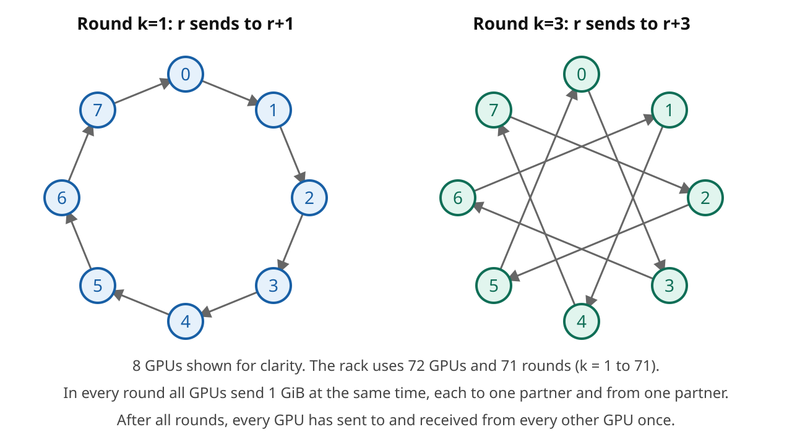

# GPU ranking (`gpu_rank/`)

`nccl_pairwise_rank` ranks every GPU of an NVL72 rack by NCCL point-to-point
bandwidth, slowest first, from **one** `mpirun` launch. `run_gpu_rank.sh` is
the wrapper that builds it, checks the nodes and launches it.

| File | What it is |
|------|------------|
| `run_gpu_rank.sh` | Run this on node-00. Checks the nodes (or repairs them with `--preflight`), builds and copies the binary, launches `mpirun`, saves the log and the matrix CSV. |
| `nccl_pairwise_rank.c` | The measurement and the analysis. One C file, built with plain `gcc`. |
| `pairwise_rounds.svg` | The diagram below. |

## Why a separate test

In All-Reduce and All-to-All every GPU waits for the slowest one, so
nccl-tests reports one busbw for the whole rack and a slow GPU stays hidden.
To find *which* GPU is slow, each GPU needs its own measurements, against many
different partners, taken while the rest of the rack is busy too.

## How the rounds work

With N GPUs (N = 72 on a full rack, rank r = node x 4 + local GPU), the job
runs N-1 rounds, k = 1 .. N-1. In round k, every rank r at the same time:

- sends 1 GiB to rank `(r + k) % N`, and
- receives 1 GiB from rank `(r - k + N) % N`,

as one NCCL group (`ncclSend` + `ncclRecv`), so every GPU is sending and
receiving in every round. Each rank times its own round (3 warmup + 10 timed
iterations by default) and records `bytes x iters / time` as GB/s, one
direction. A tiny All-Reduce acts as a barrier between rounds, so no rank
starts round k while its partners are still in round k-1.



The diagram shows 8 GPUs for clarity. After all N-1 rounds every GPU has sent
to and received from every other GPU exactly once, so every ordered pair
(i -> j) has been measured once. On 72 GPUs that is 71 rounds and
72 x 71 = 5,112 measurements, all from a single launch.

## How the score works

Each measurement that rank i takes in round k involves three GPUs: i itself,
the GPU it sends to and the GPU it receives from (two when k = N/2, where both
are the same GPU). A slow GPU or link drags down every measurement it is part
of. So for each GPU g, rank 0 computes:

| Column | Meaning |
|--------|---------|
| `score` | Mean GB/s of **every** measurement g took part in: its own N-1, plus the ones where g was the send or receive partner (about 3(N-1) values). This is what the ranking is sorted by. |
| `vsMed` | `score` as a percentage of the rack median score. |
| `own` | Mean of only g's own N-1 measurements. |
| `worst partner` | The other GPU whose shared measurements with g have the lowest mean, with that mean in brackets. |

A slow GPU is in every one of its own measurements, but a healthy GPU meets it
in only a couple of rounds. So the slow GPU's score drops a lot while everyone
else's drops only a little, and it sorts to the top. On top of that, healthy
GPUs all name the same slow GPU as their worst partner, which confirms it.

The rule of thumb printed at the end of every run: a GPU clearly below the
rack median (e.g. under 95%) whose `own` column is also low is the suspect,
and the healthy GPUs list that same suspect as their worst partner.

## How to run it

From the jumper (node-00 is the **last** IP in `CM_IPS`), copy both files into
the `run/` folder that `deploy_rack_nccl_test.sh` staged, next to
`run_nccl_test.sh`:

```bash
scp gpu_rank/nccl_pairwise_rank.c gpu_rank/run_gpu_rank.sh root@<node-00>:/root/portable-nccl/run/
ssh root@<node-00> bash /root/portable-nccl/run/run_gpu_rank.sh --preflight   # after a reboot
ssh root@<node-00> bash /root/portable-nccl/run/run_gpu_rank.sh               # otherwise
```

Options:

```bash
bash run_gpu_rank.sh                    # full rack
bash run_gpu_rank.sh 9                  # first 9 nodes only (same rule as run_nccl_test.sh)
bash run_gpu_rank.sh --preflight        # after a reboot: repair node state first
bash run_gpu_rank.sh -- -b 2G -n 20     # pass options to nccl_pairwise_rank
```

Options after `--` go to the binary: `-b` bytes per transfer (default `1G`),
`-n` timed iterations per round (default 10), `-w` warmup iterations per round
(default 3).

What the script does, in order:

1. **`--preflight` only:** runs the pre-flight part of the staged
   `run_nccl_test.sh` (SSH mesh check, IMEX node list, nvidia-imex/channel0
   repair, stale-process cleanup, pack check), cut out of that file up to its
   `=== Pre-flight complete ===` line. The All-Reduce / All-to-All sweep is
   skipped, so you do not need to run `run_nccl_test.sh` first.
2. **Build:** on first use (or when the `.c` file is newer) it builds
   `bin/nccl_pairwise_rank` with plain `gcc`. No CUDA, NCCL or MPI headers are
   needed: the binary `dlopen()`s the pack's libnccl and libcudart, and takes
   rank and size from Open MPI's environment variables. If node-00 has no
   gcc, build on any aarch64 Linux box with
   `gcc -O2 -std=gnu11 -o nccl_pairwise_rank nccl_pairwise_rank.c -ldl`
   and copy it to `bin/`.
3. **Check nodes, in parallel:** copies the binary to every node where it
   differs, and checks that nvidia-imex is active, channel0 exists and no
   stale perf process holds a GPU. Without `--preflight` it only checks and
   repairs nothing; if a node is not ready it tells you to rerun with
   `--preflight`.
4. **Launch:** one `mpirun`, 4 ranks per node, with the same mpirun flags and
   NCCL env as `run_nccl_test.sh`, so the numbers are comparable.
   `NCCL_COMM_ID` (node-00, port 29517) replaces MPI for the NCCL bootstrap.

Pre-flight lines and the tables label nodes `nNN/IP` (for example
`n07/192.168.41.147`, n00 = node-00), in hostfile order, because every node of
a rack can share one hostname.

## Outputs

Everything is printed to the screen and saved on node-00 under `run/results/`:

| File | Contents |
|------|----------|
| `<timestamp>_<N>node_gpu_rank.log` | The full run: progress, then the three tables below. |
| `<timestamp>_<N>node_gpu_rank_matrix.csv` | The raw N x N pair matrix. |

### The three tables

1. **GPU ranking, slowest -> fastest:** position, rank, host, PCI busId,
   `score`, `vsMed`, `own`, and the worst partner.
2. **By location:** the same GPUs in rank order (node, then GPU), with each
   GPU's speed position `#` (1 = slowest). Use it to find a GPU on a tray.
3. **Per-node mean score, slowest -> fastest:** the mean score of the 4 GPUs
   of each node (tray), with their ranks.

### The rank matrix CSV

Shape of the file (values here are only an illustration):

```
from\to,0,1,2,...
0,,612.40,587.10,...
1,598.30,,610.80,...
```

- Row = the sending rank, column = the receiving rank, value = GB/s (one
  direction) that the **sender** measured in the round where it sent to that
  column. The diagonal is empty.
- Cell (i, j) comes from round `k = (j - i + N) % N`. In that same round, i
  was also receiving from `(i - k + N) % N`, so a low cell can be caused by i,
  by j, or by i's receive partner. Look for a whole row **and** column that is
  low: that is the slow GPU.
- Cells next to the diagonal (neighbour rounds, r +- 1, r +- 2) are naturally
  slower and are not a fault (see the reference below).

## Try it without GPUs

```bash
gcc -O2 -std=gnu11 -o nccl_pairwise_rank nccl_pairwise_rank.c -ldl
./nccl_pairwise_rank --selftest [N] [slow_rank] [factor]   # defaults: 72 37 0.7
```

This feeds the analysis synthetic data (700 GB/s with +-1% noise, one GPU at
`factor` speed) and prints the same tables. For example,
`--selftest 8 5 0.7` gives:

```
   #  rank  host                 busId              score  vsMed       own  worst partner (shared GB/s)
   1     5  node01               0000:09:00.0       490.4  75.8%     490.3  <-> rank 7 node01 0000:0b:00.0 (489.3)
   2     7  node01               0000:0b:00.0       617.0  95.4%     641.4  <-> rank 5 node01 0000:09:00.0 (489.3)
   3     3  node00               0000:0b:00.0       617.6  95.5%     640.0  <-> rank 5 node01 0000:09:00.0 (491.9)
   ...
   8     0  node00               0000:08:00.0       658.1 101.7%     642.1  <-> rank 5 node01 0000:09:00.0 (491.7)
```

Rank 5 is on top with a low `own`, and every other GPU names it as its worst
partner.

## Healthy reference

Known-good GB300 NVL72 rack, NCCL 2.28.7, 1 GiB, 3 runs (All-Reduce
~927 GB/s, All-to-All ~670 GB/s):

- rack median score ~607-610 GB/s
- every GPU within ~94-108% of the median
- per-node means ~96-107%, and the tray order is stable across runs, so a
  tray at ~96% is normal spread
- no GPU repeatedly named as worst partner
- neighbour rounds (r +- 1, r +- 2) are slower (~210-500 GB/s shared); this is
  normal

On a bad (NG) rack, look for a GPU or node well below this band (e.g. under
90%) that the healthy GPUs share as their worst partner.
